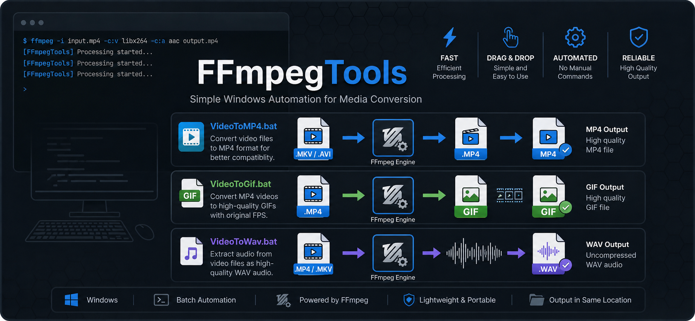

# Fluxo (FFmpegTools)



<p align="center">
  <a href="https://github.com/nithingoud78/FFmpegTools/releases/latest/download/Fluxo.exe">
    
  </a>
  &nbsp;&nbsp;
  <a href="https://github.com/nithingoud78/FFmpegTools/releases/latest/download/Fluxo.apk">
    
  </a>
</p>

<p align="center">
  <a href="Fluxo.exe"><b>💾 Direct Download Windows App (Fluxo.exe)</b></a> &nbsp;&bull;&nbsp;
  <a href="Fluxo.apk"><b>📱 Direct Download Android App (Fluxo.apk)</b></a>
</p>

---

A powerful and lightweight media processing suite available as Windows batch scripts, a standalone desktop application (**Fluxo.exe**), and a mobile package (**Fluxo.apk**). Styled with a minimal ChatGPT Dark Theme, it delivers fast video conversion, high-quality GIF generation, audio extraction, universal image compression, and PDF processing with zero command-line complexity.

---

## Overview

**Fluxo** provides simple, unified media processing workflows across all devices. Leveraging the power of FFmpeg and Ghostscript behind an intuitive interface, users can convert videos, generate animated GIFs, extract studio-grade audio, compress any image format, and compress or extract PDF documents with minimal effort.

### 🌟 Key Highlights

- **Desktop App (`Fluxo.exe`)**: Standalone 64-bit Windows executable with an elegant ChatGPT dark theme, multi-file selection, parameter customization, and live activity logs.
- **Mobile App (`Fluxo.apk`)**: Installable Android package (Android 12+, API 31–34) optimized for smartphones and tablets with responsive touch controls.
- **Batch Scripts (`.bat`)**: Lightweight drag-and-drop Windows batch scripts for quick zero-UI conversions.
- **Universal Image Compressor**: Supports **all** image formats (PNG, JPG, JPEG, WebP, BMP, TIFF, GIF) with custom target KB size constraints.
- **Automatic Same-Path Saving**: All converted files automatically save into the **exact same source folder** as the original files.

---

## Features

- **Convert video files to MP4**: Universal H.264 + AAC encoding.
- **Convert videos to high-quality GIFs**: Two-pass palette generation preserving FPS and resolution.
- **Extract audio as WAV**: Studio uncompressed 16-bit 44.1 kHz PCM audio.
- **Universal Image Compression**: Compresses **all** image formats (PNG, JPG, WebP, BMP, TIFF, GIF) to fit a user-defined target KB range with Lanczos resampling and quality optimization.
- **PDF Compression**: Multi-tier Ghostscript compression profiles to hit a target maximum size (MB/KB).
- **PDF to High-Definition Images**: Converts PDF pages to 300 DPI images (JPG, PNG, TIFF, BMP, SVG, PPM) with automatic page numbering.
- **Drag-and-Drop Workflow**: Supports single or batch files.
- **Same Directory Output**: Never misplaces your converted files.
- **Zero Configuration Required**: Ready-to-run executables.

---

## Included Applications & Utilities

### 1. Fluxo Desktop Application (`Fluxo.exe`)
A standalone 64-bit Windows application built with a modern ChatGPT Dark Mode UI:
- **Sidebar Navigation**: Switch seamlessly between video, audio, image, and PDF tools.
- **Customizable Controls**: Set target Min/Max KB for images, target size for PDFs, and DPI/format for PDF-to-image conversions.
- **Live Terminal Console**: Real-time progress monitoring and file size reduction statistics.
- **Open Source Folder**: One-click button to view converted files in File Explorer.

### 2. Fluxo Android Application (`Fluxo.apk`)
An installable mobile package cryptographically signed with APK Signature Schemes v2 + v3:
- Fully responsive mobile UI with clean ChatGPT aesthetic.
- In-browser/WebView processing with client-side image compression, audio encoding, and instant downloads.

### 3. Windows Batch Scripts (`.bat`)

#### `VideoToMP4.bat`
Converts supported video files into MP4 format for universal device compatibility.

#### `VideoToGif.bat`
Creates high-quality animated GIFs from videos using FFmpeg's two-pass palette generation.
- Preserves original frame rate and resolution.
- Automatically removes temporary palette files.
- Supports dragging multiple files simultaneously.

#### `VideoToWav.bat`
Extracts audio from video files and saves it as an uncompressed 16-bit 44.1 kHz WAV file.

#### `ImageCompressor.bat`
Compresses any image format (PNG, JPG, WebP, BMP, TIFF, GIF) into a specified KB size range (e.g., 50 KB – 150 KB).
- Supports all major image extensions.
- Multi-pass Lanczos scaling and format-aware compression.
- Saves output as `<filename>_compressed.<ext>`.

#### `PDFCompressor.bat`
Compresses PDF documents to meet a target maximum file size (e.g., `2MB`, `500KB`) using multi-tier Ghostscript profiles (180 DPI down to 60 DPI).
- Automatically detects duplicate images and subsets fonts.
- Saves output as `<filename>_compressed.pdf`.

#### `PDFToImage.bat`
Converts PDF document pages into high-resolution 300 DPI images.
- Supports JPG, PNG, TIFF, BMP, SVG, and PPM formats.
- Generates sequentially numbered pages (`<filename>_page_001.<ext>`).

---

## Repository Structure

```text
FFmpegTools/
│
├── Assets/
│   ├── Banner.png                # Repository header banner
│   ├── logo.png                  # High-resolution brand logo (1024x1024)
│   └── logo.ico                  # Multi-size Windows application icon
│
├── mobile_app/
│   ├── index.html                # Responsive mobile web app
│   └── logo.png                  # Mobile asset logo
│
├── Fluxo.exe                     # Standalone Windows Desktop App
├── Fluxo.apk                     # Signed Android Mobile Application Package
├── fluxo_gui.py                  # Python GUI source code
│
├── ImageCompressor.bat           # Universal Image Compression Script
├── PDFCompressor.bat             # Multi-Tier PDF Compression Script
├── PDFToImage.bat                # 300 DPI PDF to Image Conversion Script
├── VideoToMP4.bat                # Video to MP4 Conversion Script
├── VideoToGif.bat                # High-Quality Video to GIF Script
├── VideoToWav.bat                # Video to WAV Audio Extraction Script
│
├── LICENSE                       # MIT License
└── README.md                     # Documentation
```

---

## Requirements

### For Batch Scripts & Desktop App

- **FFmpeg**: Required for video, audio, and image processing (`VideoToMP4.bat`, `VideoToGif.bat`, `VideoToWav.bat`, `ImageCompressor.bat`, and `Fluxo.exe`).
  1. Download FFmpeg: https://ffmpeg.org/download.html
  2. Add the FFmpeg `bin` folder to your system PATH.
  3. Verify installation: `ffmpeg -version`

- **Ghostscript**: Required for PDF compression and conversion (`PDFCompressor.bat`, `PDFToImage.bat`, and `Fluxo.exe`).
  1. Download Ghostscript: https://ghostscript.com/releases/gsdnld.html
  2. Install Ghostscript (e.g., `gswin64c.exe`).
  3. Add the Ghostscript `bin` folder to your system PATH or place `gswin64c.exe` in the application directory.
  4. Verify installation: `gswin64c -version`

### For Android APK
- Compatible with **Android 12 (API 31) and higher**. No external dependencies needed; everything is self-contained.

---

## Usage Guide

### Desktop Application (`Fluxo.exe`)
1. Double-click `Fluxo.exe` to launch the app.
2. Select your desired utility from the left sidebar.
3. Click **Browse & Select Files** (or drag and drop).
4. Configure target options (e.g. Min/Max KB for images, target size for PDFs).
5. Click **Start Processing**. Converted files are automatically saved in the original file's folder.

### Android Application (`Fluxo.apk`)
1. Transfer `Fluxo.apk` to your Android device or download it directly.
2. Tap the APK file to install (enable "Install unknown apps" if prompted).
3. Open **Fluxo** and tap any tool to select files and run conversions.

### Batch Scripts
Simply drag and drop your media file(s) directly onto the corresponding `.bat` file in Windows Explorer.

---

## Author

Developed and maintained by **K Nithin Kumar Goud**.

Bachelor of Engineering, Electronics and Communication Engineering (ECE).

---

⭐ If you found this project useful, consider giving the repository a star!
